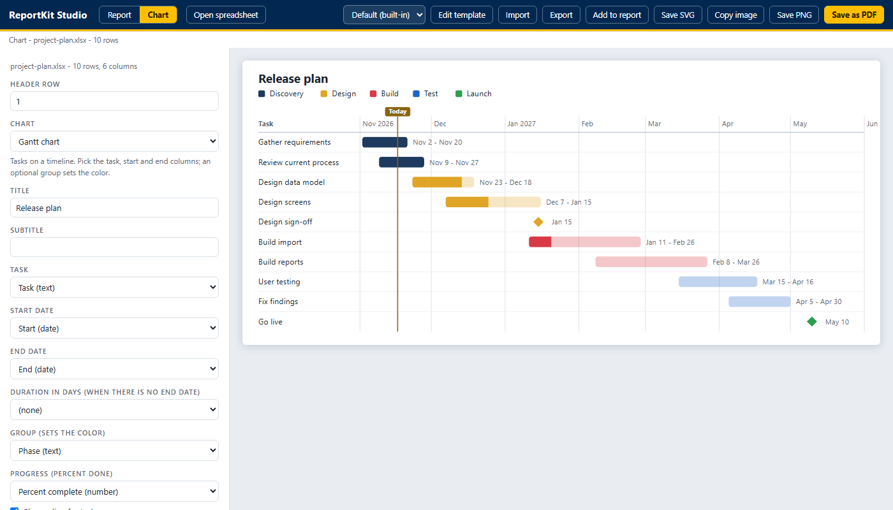
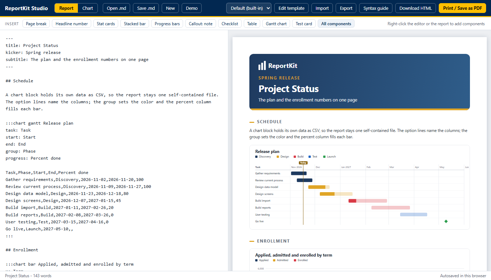
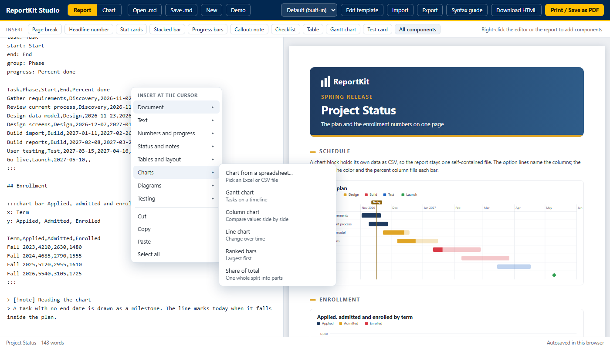
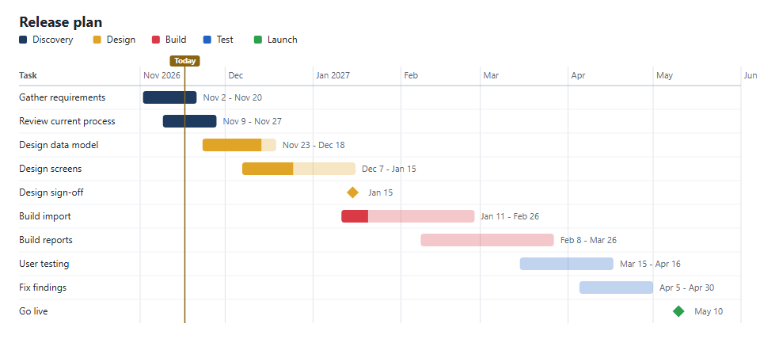
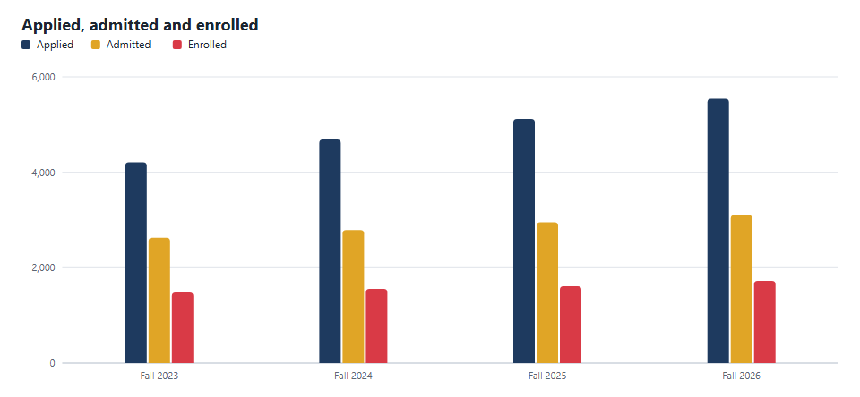
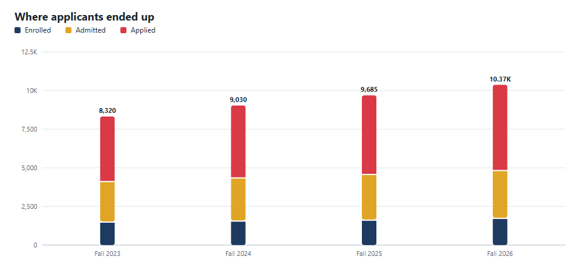
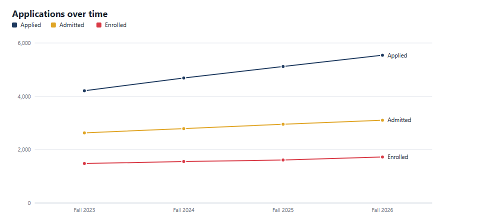
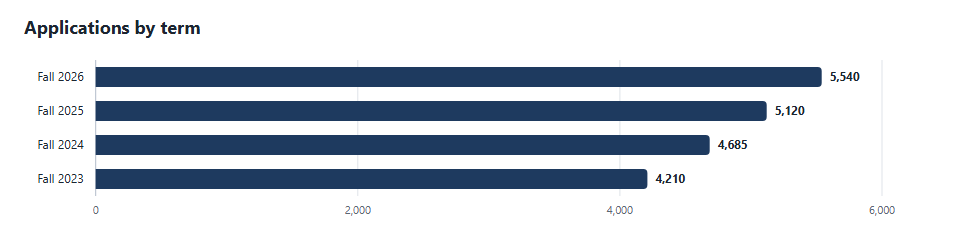
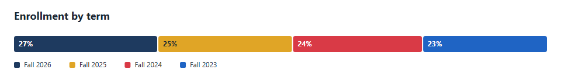
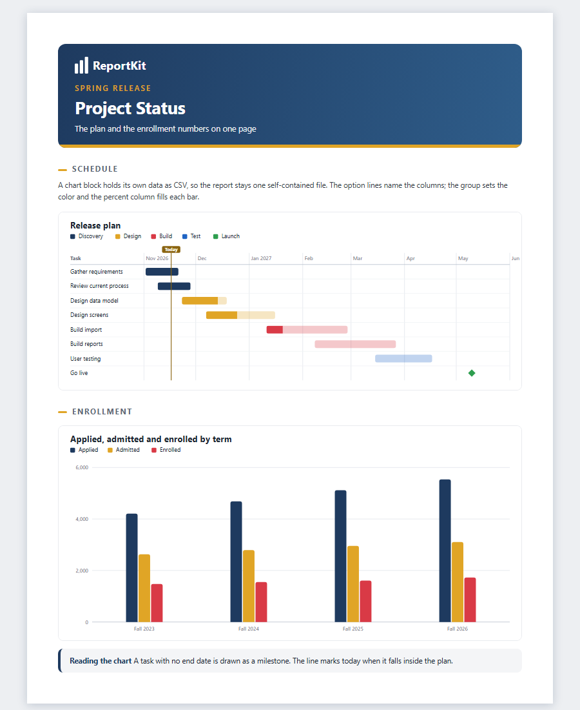

# ReportKit

Drop in a spreadsheet and get a chart or a Gantt chart in your template colors, or write a report as plain markdown with a few extra marks and get a finished, styled report: a header band, progress bars, stat cards, status pills, callouts, tables and UML diagrams. It runs offline as a desktop app, a single HTML file, or a command line tool, and the whole look (palette, font, logo, images) comes from a template file you can swap, import and export.



## Quick start

Open `dist/studio.html` after `npm run build`, or run the desktop app:

```bash
npm install
npm start
```

Press **Demo** in the Studio to load a guided tour: each mark is shown as the text you write beside the result you get.

The Studio edits the markdown on the left and shows the finished report on the right. Print it to PDF or download it as HTML.



### Build a report by right-clicking

You do not need to know the markup. Right-click in the editor and pick a component: sections, headline numbers, stat cards, tables, callouts, charts, diagrams or a test card. It is inserted at the cursor with its placeholder text selected, so you type over it, and Ctrl+Z takes it back out. Right-click the finished report to add a component to the end. The Insert toolbar has the common ones as buttons that you can click or drag into the text, and **All components** opens the full menu. Hold Shift while right-clicking to get the browser's own menu.



The **Document** group fills in the header: a title block, a full-page cover, a contents page, and a source and footer line. **Charts > Chart from a spreadsheet** takes you to Chart mode, and **Add to report** brings the chart back as a block. The components live in `studio/components.js`; add an entry there and it appears in the menu.

From the command line:

```bash
node src/cli.js report.md report.pdf
node src/cli.js report.md report.html --template my-brand.rktemplate.json
node src/cli.js --export-template my-brand.rktemplate.json
```

PDF output needs Chrome, Edge or Chromium installed (set `REPORTKIT_BROWSER` to its path if it is not found). The desktop app prints PDFs itself.

## Charts from a spreadsheet

Press **Chart** in the Studio, drop in an `.xlsx`, `.csv` or `.tsv` file, and pick the columns. The file is read on your computer; nothing is uploaded. The chart is drawn in the active template's colors, so a template change restyles it.

| Chart | Columns you pick |
|---|---|
| Gantt chart | Task, start date, end date (or duration in days), and optionally a group (sets the color) and a progress column. A task with no end date is a milestone |
| Column chart, stacked columns, line, area | Categories or dates, and one or more number columns |
| Ranked bars | Names and one or more number columns, largest first |
| Share of total | Names and one number column; more than six parts fold into Other |



Every chart type, drawn from the same sample workbooks in `examples/` (`project-plan.xlsx` and `enrollment.xlsx`), in the default template:

<table>
<tr>
<td width="50%"><br><sub>Column chart</sub></td>
<td width="50%"><br><sub>Stacked columns</sub></td>
</tr>
<tr>
<td width="50%"><br><sub>Line chart</sub></td>
<td width="50%"><br><sub>Ranked bars</sub></td>
</tr>
<tr>
<td colspan="2"><br><sub>Share of total</sub></td>
</tr>
</table>

The Studio guesses the columns from their names and contents (dates, numbers, words like Start, End, Phase, Progress), so most sheets draw correctly on the first try. If the header is not on the first row, set **Header row**. Export with **Save SVG**, **Save PNG**, **Copy image** (paste into a slide or document) or **Save as PDF**, or press **Add to report** to place the chart in a report as a `:::chart` block that carries its own data.

### A chart inside a report

`Add to report` writes a `:::chart` block: option lines that name the columns, then the data as CSV. The report is still one text file. This is `examples/chart-report.md`:

````markdown
:::chart gantt Release plan
task: Task
start: Start
end: End
group: Phase
progress: Percent done

Task,Phase,Start,End,Percent done
Gather requirements,Discovery,2026-11-02,2026-11-20,100
Design data model,Design,2026-11-23,2026-12-18,80
Build import,Build,2027-01-11,2027-02-26,20
Go live,Launch,2027-05-10,,
:::
````



For a column, line, area, stacked or ranked chart, name the category column with `x:` and the value columns with `y:`, for example `y: Applied, Enrolled`. A Gantt option line can also use `duration:` instead of `end:`.

### From the command line

```bash
node src/cli.js chart plan.xlsx plan.svg --task Task --start Start --end End --group Phase --title "Project plan"
node src/cli.js chart counts.xlsx counts.pdf --type bar --x Term --y "Applied,Enrolled"
```

Dates read as 2026-03-14, 3/14/2026, 14 Mar 2026 or Mar 14, 2026, or as dates in Excel. Older `.xls` and password-protected workbooks are not supported; save as `.xlsx` or CSV.

## Markdown+

Everything in plain markdown works. A number becomes a metric only when you mark it; nothing is inferred from prose.

| Write | Get |
|---|---|
| `---` block with `title`, `kicker`, `subtitle`, `source`, `footer` | Header band and footer line |
| `cover: full` in the `---` block, with `tagline`, `byline`, `author`, `version`, `date` | Full-page cover in place of the header band (see `examples/cover.md`) |
| `contents: yes` in the `---` block | Contents page after the cover, built from the section headings |
| `- [80%] Label {blue}` or `- [45/60] Label` | Progress bar; a list of these stacks as meters |
| `[70%]` or `[45/60]` in a table cell | Mini bar in the cell |
| `:::stats` with lines `- 55 \| Label \| Sub \| color` | Big-number cards |
| `:::bar Title` with lines `- 55 Label {color}` | One stacked bar sized by the numbers, with legend |
| `:::hero 76% \| Label`, headline line, paragraph line | Donut ring with headline |
| `[[Done]]`, `[[Blocked\|red]]` | Status pill; common words pick a color |
| `> [!good] Title` then `>` body lines | Callout: note, good, warn, bad |
| `- [x]` / `- [ ]` | Checklist |
| `:::defs` with lines `- Term :: meaning` | Definition grid |
| `:::panel Title`, `:::columns` split by a `\|\|\|` line | Boxed group, two columns |
| `:::testcard 1 Title` with `Key :: value` meta lines, markdown, then `Pass: ...` and `Fail: ...` | Numbered test card: a title and description, a meta row, `Link:` and `Record:` lines, a `**Label** · note` heading, and closing green Pass and red Fail boxes |
| `::::example` | Shows the text you wrote beside the result; add `stack` to put the result below |
| `:::chart gantt Title` with option lines (`task: Task`, `start: Start`, `end: End`, `group: Phase`) then the data as CSV | A chart drawn from the data in the block; types are gantt, bar, hbar, stacked, line, area, share |
| `` ```mermaid `` | UML, flow or Gantt diagram, drawn offline |
| `::: mermaid` ... `:::` | The same diagram written the Azure DevOps wiki way, so wiki pages render as-is |
| `[[_TOC_]]` | Contents list of the section headings (the Azure DevOps wiki tag) |
| `` | An image stored in the active template |
| `<!-- pagebreak -->` | New printed page |

A block closes on a line with exactly as many colons as opened it, so nest by giving the outer block more colons.

Mark colors are `blue gold green sage amber red grey`. In a template, blue is the primary color and gold is the accent.

## Templates

A template is one JSON file, `*.rktemplate.json`. It holds a name, a twelve-color palette, a font stack, a logo and named image assets.

```json
{
  "format": "reportkit-template",
  "version": 1,
  "name": "Example",
  "colors": {
    "primary": "#1e3a5f", "primary2": "#2f5d8a", "accent": "#e0a526", "accentDeep": "#8a6410",
    "ink": "#1c2530", "muted": "#5b6774", "success": "#2e9e4f", "sage": "#7cc9a0",
    "warning": "#e08a1a", "danger": "#d93a46", "info": "#1f64c4", "grey": "#c4c9cf"
  },
  "font": "\"Segoe UI\",Arial,sans-serif",
  "logo": { "svg": "<svg ...>", "height": 26, "color": "#ffffff" },
  "assets": { "diagram": "data:image/png;base64,..." }
}
```

- **Logo:** `svg` markup (it takes the `color` value) or `src` as a `data:image/...` URI. Use `"logo": null` for none.
- **Assets:** `data:image/...` URIs only, referenced in a report as ``.
- **Tints and shades** (borders, pill backgrounds, text on colored fills) are derived from the palette, so twelve colors restyle the whole report.
- **Studio:** use **Edit template** to change colors, the logo and images with a live preview, **Export** to save the file, and **Import** to load one. Templates you save are kept in the app.
- **CLI:** `--template file.rktemplate.json`. `--export-template` writes the built-in default as a starting point; the same file is in `templates/default.rktemplate.json`.

Templates from other people are treated as untrusted data: colors must be hex values, SVG logos are stripped of scripts and event handlers, and assets must be data images.

## Build the desktop app

```bash
npm run dist            # portable exe and installer in release/
npm run dist:portable   # portable exe only
```

The build uses electron-builder. Code signing is off, so Windows SmartScreen may warn on first run.

## Project layout

| Path | What it is |
|---|---|
| `src/render.js` | The renderer and template rules. Pure, runs in node and the browser |
| `src/sheet.js`, `src/charts.js` | Spreadsheet reader (.xlsx and CSV, no dependencies) and the SVG chart drawer |
| `src/cli.js`, `src/pdf.js` | Command line and PDF through an installed browser |
| `studio/` | Studio source (the component menu is `components.js` and `menu-ui.js`); `npm run build` inlines everything into `dist/studio.html` |
| `electron/` | Desktop shell and native PDF export |
| `templates/` | The default template as a file |
| `docs/images/` | The screenshots in this file |
| `examples/` | `demo.md`, `sample.md`, `chart-report.md`, and sample spreadsheets (`project-plan.xlsx`, `enrollment.xlsx`) |
| `vendor/` | Bundled Mermaid, see `NOTICE.md` |

Run the tests with `npm test`.

## License

MIT. See `LICENSE` and `NOTICE.md`.
