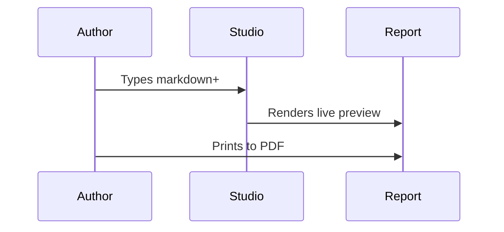

:::hero 100% | Plain text
Everything on this page started as plain text
Each example below shows the text you write, then the report element it produces. The header band, the ring, the bars and the tables all come from one file you can edit in any text editor.
:::

## How it works

1. Write a markdown file. Headings, lists, tables and bold text work as usual.
2. Add a few extra marks where you want a metric, a status or a callout.
3. Preview it live in Report Studio, or run the command line tool.
4. Print to PDF, or download a self-contained HTML file.

Nothing is guessed. A number becomes a metric only when you mark it, so a plain sentence that happens to contain "45 of 60" stays a sentence.

## The header band

The block of settings at the very top of the file, between two lines of three dashes, fills the band and the footer.

```
---
title: Release Status
kicker: Platform Engineering
subtitle: Prepared for the steering group
source: Work item board, queried October 2026
footer: Delivery Report
---
```

## Marking metrics

### A progress bar

Write a task-list style item with a percentage or a count in the brackets. Add a color in braces if you want one.

::::example
- [100%] Import tool {green}
- [80%] Export tool {blue}
- [45/60] Notification templates {amber}
- [12%] Dark mode {red}
::::

### Big-number cards

::::example
:::stats
- 55 | Complete | 55% of total | green
- 20 | In review | 20% of total | blue
- 18 | In progress | 18% of total | amber
- 7 | Not started | 7% of total | grey
:::
::::

### One bar split into parts

The numbers set the widths, so you never work out percentages by hand.

::::example stack
:::bar Work items by state
- 55 Complete {green}
- 20 In review {sage}
- 18 In progress {amber}
- 7 Not started {grey}
:::
::::

### A headline ring

::::example stack
:::hero 76% | Overall complete
Most of the quarter's scope is shipped
The first line is the headline and the next line is the supporting sentence.
:::
::::

## Status and emphasis

### Pills

Common words choose their own color. Add a vertical bar and a color name to override.

::::example
Import tool: [[Done]] · Export tool: [[In review]] · Template audit: [[In progress]] · Kiosk: [[Blocked]] · Dark mode: [[Parked|gold]]
::::

### Callouts and checklists

::::example
> [!good] Resolved.
> The import fixes are on production and signed off.

> [!warn] Watch for.
> Notification templates depend on the college scoping decision.

- [x] Verify on the Test site
- [x] Brief the Product Owner
- [ ] Schedule production deploy
::::

## Tables

A bar written in a table cell becomes a small bar, and a pill works anywhere.

::::example stack
| Item | Owner | Progress | State |
|---|---|---|---|
| Import tool | Alex | [100%] | [[Done]] |
| Export tool | Alex | [80%] | [[In review]] |
| Template audit | Sam | [45/60] | [[In progress]] |
| Kiosk check-in | Unassigned | [0%] | [[Blocked]] |
::::

## Structure

### A definition grid

::::example
:::defs
- Complete :: Merged, deployed, and verified on the Test site.
- In review :: Built and waiting on sign-off.
- Parked :: Intentionally not started.
- Blocked :: Cannot proceed without an outside decision.
:::
::::

### A boxed panel and two columns

:::::example stack
::::panel What changed this week
Two items moved to review and one was blocked.

:::columns
**Shipped**
- Import tool fixes
- Export tool

|||

**Next**
- Template audit
- Kiosk check-in
:::
::::
:::::

Blocks nest by giving the outer block more colons. A block closes only on a line of exactly as many colons as opened it, so the panel above uses four, the columns inside it use three, and the example around them uses five.

## Diagrams

A mermaid fence draws a UML or flow diagram from text. The drawing library is bundled, so it works with no internet connection.

::::example stack

::::

## Getting the finished report

| Want | Do |
|---|---|
| Edit with a live preview | Open `report-studio.html`, one file, works offline |
| A PDF from the command line | `node reportkit/cli.js in.md out.pdf` |
| A shareable web page | Download HTML in the Studio, or `cli.js in.md out.html` |
| A new printed page | Put `<!-- pagebreak -->` on its own line |

> [!note] Try it now.
> In Report Studio, press Demo to load this page, change a number in any example, and watch the report update.
